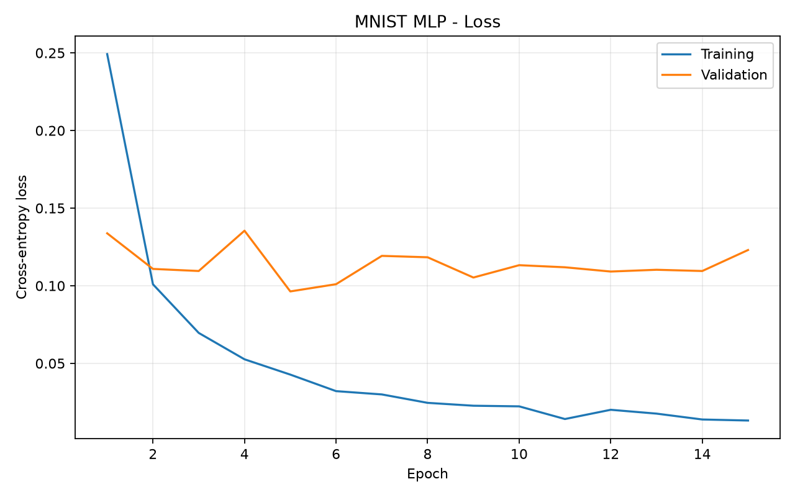
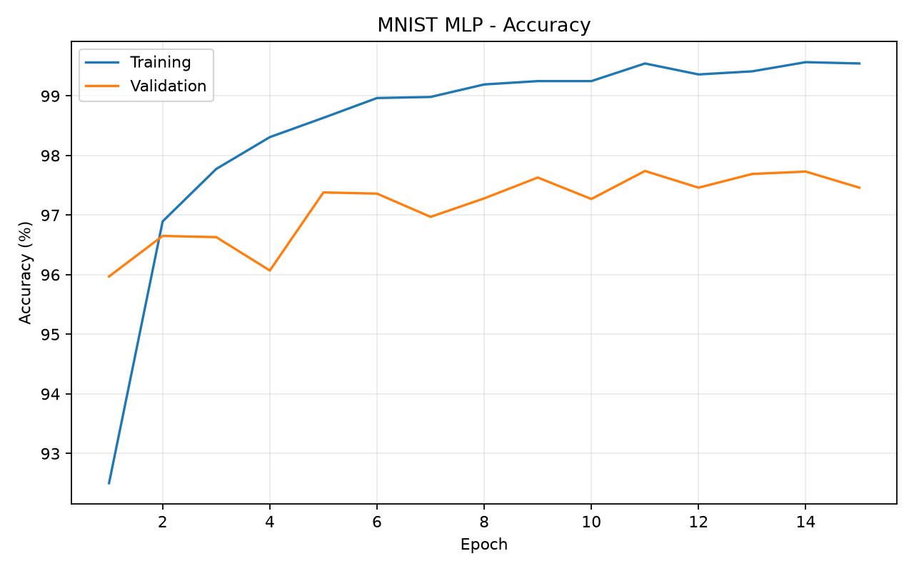
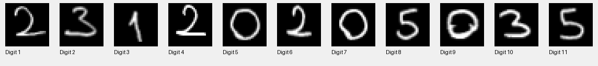
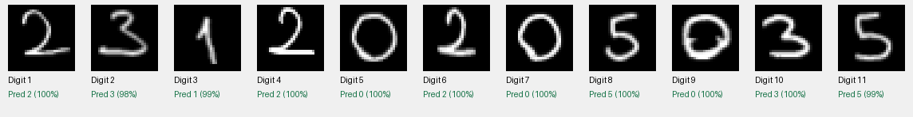

# Çok Katmanlı Algılayıcı (MLP) ile MNIST El Yazısı Rakam Tanıma

**Dil / Language:** [Türkçe](README_TR.md) | [English](README.md)

**Derin Öğrenme Dersi — Deneysel Ödev**  
**Kütüphane:** PyTorch  
**Model:** Sıfırdan eğitilmiş Çok Katmanlı Algılayıcı (Multi-Layer Perceptron, MLP)

### Öğrenci Bilgileri

| Bilgi | Değer |
|---|---|
| Ad soyad | Kerem YILMAZ |
| Öğrenci numarası | 23120205035 |
| Ders | BIL485 Derin Öğrenme |

## 1. Projeye Genel Bakış

Bu projede, MNIST veri seti kullanılarak tam bağlantılı bir Çok Katmanlı Algılayıcı (MLP) ile el yazısı rakam tanıma problemi incelenmiştir. Projenin amaçları şunlardır:
- 0–9 arasındaki rakamları sınıflandırmak için en az iki gizli katmanlı bir MLP eğitmek.
- Eğitim ve doğrulama kayıp (loss) ve doğruluk (accuracy) değerlerini epoch boyunca takip etmek.
- Veri ayrımını ve diğer ayarları sabit tutarak model kapasitesini ve öğrenme hızını karşılaştırmak.
- Seçilen modeli ayrı bir MNIST test kümesinde ve kendi el yazımla yazdığım öğrenci numarasının fotoğrafında değerlendirmek.
- Aşırı öğrenme (overfitting), genelleme (generalization) ve küçük bir gerçek dünya örnekleminin sınırlılıklarını tartışmak.

**Evrişimli sinir ağı (CNN) veya önceden eğitilmiş model kullanılmamıştır.** MLP'nin ağırlıkları başlangıçta oluşturulmuş ve eğitim sırasında öğrenilmiştir.

## 2. Veri Seti ve Ön İşleme

[MNIST](https://www.tensorflow.org/datasets/catalog/mnist), 0–9 arasındaki el yazısı rakamlardan oluşan 70.000 gri tonlamalı görüntü içerir. Her görüntünün boyutu 28 × 28 pikseldir.

| Veri kümesi | Görüntü sayısı | Kullanım amacı |
|---|---:|---|
| Eğitim (train) | 50.000 | Model ağırlıklarını güncellemek |
| Doğrulama (validation) | 10.000 | Eğitimi izlemek ve model checkpoint'ini seçmek |
| Test | 10.000 | Daha önce görülmemiş MNIST görüntülerindeki başarıyı raporlamak |

Eğitim ve doğrulama kümeleri, MNIST'in orijinal 60.000 görüntülük eğitim bölümünün rastgele ve tekrarlanabilir şekilde ayrılmasıyla oluşturulmuştur (`seed = 42`). Resmî 10.000 görüntülük test bölümü ayrı tutulmuştur. Üç deneyde de aynı veri ayrımı kullanılmıştır.

MNIST görüntüleri kayan noktalı tensorlara dönüştürülmüş ve şu formülle normalize edilmiştir:

```text
normalized_pixel = (pixel_in_[0,1] - 0.1307) / 0.3081
```

MLP, 28 × 28 boyutundaki her görüntüyü 784 elemanlı bir giriş vektörüne dönüştürür. Modelde evrişim katmanı bulunmaz.

## 3. Model Mimarisi

Temel modelde ReLU aktivasyonlu, tam bağlantılı iki gizli katman vardır:

```text
Giriş: 28 × 28 gri tonlamalı görüntü
          |
       Flatten
          |
    Linear(784, 256)
          |
         ReLU
          |
    Linear(256, 128)
          |
         ReLU
          |
     Linear(128, 10)
          |
   10 sınıf skoru (0–9)
```

Modelin ürettiği ham sınıf skorları (*logits*), sınıflandırma kaybını hesaplayan PyTorch `CrossEntropyLoss` fonksiyonuna doğrudan verilir. Tahmin aşamasında ise rakam bazında güven skorlarını görüntülemek için `softmax` kullanılır.

### Eğitim Ayarları

| Hiperparametre | Değer |
|---|---|
| Kayıp fonksiyonu | CrossEntropyLoss |
| Optimizasyon algoritması | Adam |
| Batch size | 64 |
| Maksimum epoch | 15 |
| Rastgelelik tohumu | 42 |
| Temel modelin gizli katman boyutları | 256, 128 |
| Temel modelin öğrenme hızı | 0.001 |
| Aktivasyon fonksiyonu | ReLU |
| Giriş normalizasyonu | Ortalama 0.1307, standart sapma 0.3081 |
| Model seçme ölçütü | En düşük doğrulama kaybı |

Her epoch için eğitim ve doğrulama loss/accuracy değerleri kaydedilmiştir. En düşük doğrulama kaybının elde edildiği epoch'un ağırlıkları `best_model.pt` olarak saklanmıştır. MNIST test değerlendirmesi, eğitim tamamlandıktan sonra seçilen checkpoint kullanılarak yapılmıştır; test verisi ağırlıkları güncellemek veya checkpoint seçmek için kullanılmamıştır.

## 4. Deneyler

Gizli katmanlardaki nöron sayısının ve öğrenme hızının etkisini incelemek için üç farklı yapılandırma eğitilmiştir. Diğer ayarlar aynı tutulmuştur.

| Deney | Gizli katmanlar | Öğrenme hızı | Eğitilebilir parametre |
|---|---|---:|---:|
| **1 — Temel MLP (Baseline)** | 256 → 128 | 0.001 | 235.146 |
| **2 — Küçük MLP (Smaller MLP)** | 128 → 64 | 0.001 | 109.386 |
| **3 — Düşük Öğrenme Hızı (Lower LR)** | 256 → 128 | 0.0001 | 235.146 |

### 4.1 Sayısal Sonuçlar

Aşağıdaki eğitim ve doğrulama metrikleri, her deneyde **doğrulama kaybının en düşük olduğu seçilmiş epoch'a** aittir; bu epoch her zaman son epoch değildir.

| Metrik | Temel MLP | Küçük MLP | Düşük LR |
|---|---:|---:|---:|
| En iyi epoch | 5 | 6 | 15 |
| Eğitim kaybı | 0.0428 | 0.0439 | 0.0319 |
| Doğrulama kaybı | 0.0963 | 0.0932 | **0.0876** |
| Eğitim doğruluğu | %98.63 | %98.61 | %99.19 |
| Doğrulama doğruluğu | %97.38 | %97.29 | %97.16 |
| Test doğruluğu | **%97.76** | %97.61 | %97.73 |
| Eğitim süresi | 83.6 sn | 181.1 sn | 95.9 sn |

*Eğitim süreleri, CUDA destekli bir bilgisayardaki tek çalıştırmadan elde edilmiştir; kontrollü bir performans kıyaslaması değildir.* Küçük modelin parametre sayısı daha az olmasına rağmen bu çalıştırmada daha uzun sürmesi, sistem yükü ve diğer çalışma koşullarından etkilenmiş olabilir.

### 4.2 Eğitim Grafikleri

Her deney için eğitim ve doğrulama grafikleri kaydedilmiştir:

**Temel MLP — Kayıp (Loss)**



**Temel MLP — Doğruluk (Accuracy)**



Diğer grafikler:

- [Küçük MLP: loss](results/smaller/loss.png) · [accuracy](results/smaller/accuracy.png)
- [Düşük öğrenme hızı: loss](results/lower_lr/loss.png) · [accuracy](results/lower_lr/accuracy.png)

Her deneyin epoch bazındaki metrikleri `history.csv`, özet sonuçları ise `summary.json` dosyalarında bulunmaktadır.

### 4.3 Sonuçların Yorumlanması

**Temel MLP (256 → 128, öğrenme hızı 0.001).** Model hızlı öğrenmiştir. En düşük doğrulama kaybına 5. epoch'ta (`0.0963`) ulaşmıştır. Sonrasında eğitim kaybı azalmaya devam ederken doğrulama kaybı dalgalanmış ve 15. epoch'ta `0.1230` değerine çıkmıştır; aynı noktada eğitim kaybı `0.0132` olmuştur. İki değer arasındaki bu açılma, aşırı öğrenmeye (overfitting) işaret etmektedir: Eğitim verisine daha iyi uyum sağlanması, doğrulama başarısını sürekli artırmamıştır.

**Küçük MLP (128 → 64, öğrenme hızı 0.001).** Gizli katmanların küçültülmesiyle eğitilebilir parametre sayısı 235.146'dan 109.386'ya düşmüştür (yaklaşık **%53,5 azalma**). Buna rağmen test doğruluğu yalnızca 0,15 yüzde puan azalmıştır (%97.76'dan %97.61'e). Dolayısıyla daha küçük bir ağ, bu görevde benzer bir sınıflandırma başarısı göstermiştir. En düşük doğrulama kaybı 6. epoch'ta `0.0932` olmuştur; sonraki epoch'larda da aşırı öğrenme belirtileri gözlenmiştir.

**Düşük öğrenme hızı (256 → 128, öğrenme hızı 0.0001).** Öğrenme hızı 10 kat azaltıldığında eğitim daha yavaş başlamış, buna karşın doğrulama kaybı 15 epoch boyunca genel olarak azalmıştır. 15. epoch'ta `0.0876` ile üç deney arasındaki en düşük doğrulama kaybı elde edilmiştir. Bu çalıştırmada temel modeldeki kadar belirgin ve sürekli bir geç dönem doğrulama kaybı artışı görülmemiştir. Daha fazla epoch ile iyileşme mümkün olabilir; ancak bu denenmemiştir.

**Model seçimi.** Model seçme ölçütü **en düşük doğrulama kaybı** olduğundan, ayrı el yazısı deneyinde Düşük LR modeli kullanılmıştır. Temel modelin test doğruluğu çok az daha yüksektir (%97.76'ya karşı %97.73), ancak fark yalnızca 0,03 yüzde puandır (10.000 test görüntüsünde üç tahmin). Bu fark, anlamlı bir performans üstünlüğü olduğunu söylemek için yeterli değildir. Test doğrulukları raporlanmıştır; el yazısı modelini seçmek için kullanılmamıştır.

## 5. Kendi El Yazımla Değerlendirme

MNIST test kümesi dışındaki performansı incelemek amacıyla öğrenci numaramı bir kâğıda elle yazıp fotoğrafladım. Orijinal görüntü [`handwriting/student_number.jpg`](handwriting/student_number.jpg) konumunda bulunmaktadır.

### 5.1 Fotoğrafın İşlenmesi

Fotoğrafa aşağıdaki işlemler uygulanmıştır:

1. Yazıyı yatay hâle getirmek için fotoğrafı saat yönünün tersine 90° döndürmek.
2. Görüntüyü gri tonlamaya çevirmek ve eşikleme sonucunu ters çevirerek siyah arka plan üzerinde açık renkli rakamlar elde etmek.
3. Bağlı bileşen analizi (*connected-component analysis*) ile ayrık rakamları belirlemek ve soldan sağa sıralamak.
4. Her rakamın en-boy oranını koruyarak ön planı yaklaşık 20 × 20 piksellik bir alana sığdırmak.
5. Görüntü momentlerini kullanarak rakamı 28 × 28 piksellik bir alanın ortasına yerleştirmek.
6. Piksel değerlerini `[0, 1]` aralığına ölçeklemek ve eğitimde kullanılan MNIST ortalama/standart sapma normalizasyonunu uygulamak.

Fotoğrafta birbirinden ayrık 11 rakam vardır. Rakamlar birbirine temas etmediği için bağlı bileşen yöntemi bu görüntüde başarılı olmuştur. Bitişik rakamlar veya farklı aydınlatma koşulları için ek düzenleme gerekebilir.

**Ön işlenmiş rakamlar:**



**Model tahminleri:**



### 5.2 El Yazısı Test Sonuçları

| Değerlendirme | Sonuç |
|---|---:|
| Değerlendirilen el yazısı rakam sayısı | 11 |
| Doğru sınıflandırılan rakam | 11 |
| Yanlış sınıflandırılan rakam | 0 |
| El yazısı doğruluğu | **%100.00 (11/11)** |
| Kullanılan model | Düşük LR (256 → 128, lr = 0.0001) |
| Seçilen modelin MNIST test doğruluğu | %97.73 |

11 rakamın tamamı doğru tahmin edilmiştir. Rakam başına softmax güven skorları yaklaşık %97,5 ile %100,0 arasında değişmiştir. **Softmax güven skoru, tahminin doğru olma olasılığının kalibre edilmiş bir ölçüsü olmak zorunda değildir.**

Bu sonuç, seçilen MLP'nin ön işleme sonrasında bu gerçek el yazısı örneğini tanıyabildiğini göstermektedir. Ancak **tek fotoğraftan elde edilen 11 rakam, genel gerçek dünya doğruluğunu belirlemek için yeterli değildir.** El yazısı örneğindeki %100'lük başarı, modelin %97.73'lük MNIST test başarısından genel olarak daha iyi olduğu şeklinde yorumlanmamalıdır. Veri dağılımı farklılığını (*distribution shift*) daha güvenilir değerlendirmek için farklı koşullarda hazırlanmış çok daha fazla el yazısı örneğine ihtiyaç vardır.

Rakam bazında tahminler ve gerçek etiketler [`results/handwriting/predictions.csv`](results/handwriting/predictions.csv) ile [`predictions.json`](results/handwriting/predictions.json) dosyalarına kaydedilmiştir.

## 6. Deneylerin Yeniden Çalıştırılması

### Gereksinimler

- Python (deneyler Windows üzerinde Python 3.14 ile gerçekleştirilmiştir)
- PyTorch ve torchvision (kurulu ortam: `torch 2.11.0+cu128`, `torchvision 0.26.0+cu128`)
- NumPy, Matplotlib, Pillow, scikit-learn, OpenCV
- CUDA uyumlu NVIDIA GPU isteğe bağlıdır; kod CPU üzerinde de çalışabilir

İşletim sisteminize uygun PyTorch sürümünü [resmî PyTorch sitesindeki](https://pytorch.org/get-started/locally/) talimatlarla yükleyin. Ardından proje bağımlılıklarını kurun:

```powershell
py -3.14 -m venv .venv
.\.venv\Scripts\Activate.ps1
python -m pip install --upgrade pip
# Önce pytorch.org talimatlarıyla torch ve torchvision kurun.
python -m pip install -r requirements.txt
```

### Üç Eğitim Deneyini Çalıştırma

```powershell
# Deney 1: temel model
python train.py

# Deney 2: küçük model
python train.py --hidden1 128 --hidden2 64 --output-dir results/smaller

# Deney 3: düşük öğrenme hızı
python train.py --lr 0.0001 --output-dir results/lower_lr
```

MNIST veri seti otomatik olarak `data/` klasörüne indirilir. Her deney kendi `results/` alt klasöründe grafiklerini, epoch bazındaki metriklerini, sonuç özetini ve en iyi model checkpoint'ini üretir.

### El Yazısı Tanıma Testini Çalıştırma

Düşük LR deneyi tamamlanıp `results/lower_lr/best_model.pt` oluşturulduktan sonra:

```powershell
python predict_handwriting.py --image handwriting/student_number.jpg --rotate 90 --number 23120205035 --model results/lower_lr/best_model.pt
```

`--number` parametresi doğruluğu ölçmek için **gerçek etiketleri** sağlar; modelin tahmin girdisi olarak **kullanılmaz**. Tahmin çıktıları `results/handwriting/` klasörüne kaydedilir.

### Proje Klasör Yapısı

```text
mnist-mlp/
├── model.py                         # Tam bağlantılı MLP mimarisi
├── train.py                         # Veri yükleme, eğitim, değerlendirme, grafikler
├── predict_handwriting.py           # Fotoğraf ön işleme ve tahmin
├── requirements.txt                 # Python bağımlılıkları (PyTorch hariç)
├── .gitignore
├── README.md                        # İngilizce rapor
├── README_TR.md                     # Türkçe rapor
├── handwriting/
│   └── student_number.jpg           # Orijinal el yazısı fotoğrafı
└── results/
    ├── baseline/
    │   ├── history.csv
    │   ├── summary.json
    │   ├── loss.png
    │   └── accuracy.png
    ├── smaller/                      # Aynı deney çıktı dosyaları
    ├── lower_lr/                     # Aynı deney çıktı dosyaları
    └── handwriting/
        ├── digits/                   # 11 adet işlenmiş 28x28 PNG
        ├── mnist_preview.png
        ├── segmentation.png
        ├── prediction_preview.png
        ├── predictions.csv
        └── predictions.json
```

İndirilen MNIST verilerini (`data/`), sanal ortamı (`.venv/`) ve yerel model checkpoint dosyalarını (`*.pt`) GitHub'a eklemek zorunlu değildir; verilen komutlarla yeniden üretilebilirler. GitHub'da görsellerin görüntülenebilmesi için README dosyalarında kullanılan grafiklerin ve el yazısı sonuç görsellerinin **depoya eklenmiş olması gerekir**.

## 7. Sonuç ve Sınırlılıklar

Deneyler, CNN veya hazır eğitilmiş ağırlıklar kullanmadan, iki gizli katmanlı bir MLP'nin MNIST üzerinde yaklaşık **%97.6–%97.8 test doğruluğu** elde edebildiğini göstermiştir. Gizli katmanları küçültmek, doğrulukta küçük bir azalmayla çok daha az parametreye sahip bir model oluşturmuştur. Öğrenme hızının düşürülmesi ise ilk epoch'larda öğrenmeyi yavaşlatmış ancak 15 epoch sonunda en düşük doğrulama kaybını sağlamıştır.

Eğitim grafikleri, doğrulama sonuçlarını izlemenin önemini ortaya koymaktadır: Eğitim kaybının sürekli azalması, görülmemiş veriler üzerinde de sürekli iyileşme olacağı anlamına gelmez. Düşük LR modeli, MNIST'e benzer şekilde ön işlenen el yazısı fotoğrafındaki 11 rakamı da doğru tanımıştır. Bununla birlikte bu sınırlı örnek, modelin farklı yazı biçimlerine veya veri dağılımı değişimlerine karşı genelleme yeteneği hakkında geniş kapsamlı bir yargıda bulunmak için yeterli değildir.

İleride farklı rastgelelik tohumlarıyla tekrar deneyleri, öğrenme hızı planlaması (*learning-rate scheduling*), erken durdurma (*early stopping*) ve daha çeşitli el yazısı örnekleriyle değerlendirme yapılabilir. Bunlar **bu teslimde yapılmış deneyler değil**, olası geliştirme önerileridir.
